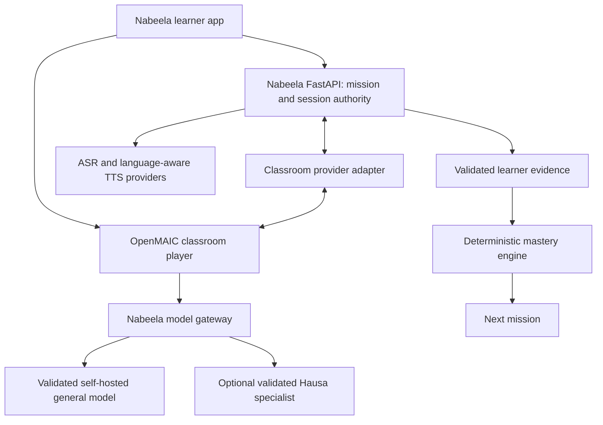

# OpenMAIC classroom integration plan

Status: proposed implementation plan. Researched 2026-10-25. No runtime changes or new services enabled.

## Product decision

Add Classroom as an optional way to deliver a Nabeela Daily Mission. Nabeela remains responsible for curriculum, learner identity, teaching policy, evidence and deterministic mastery. OpenMAIC provides classroom presentation and bounded teacher/classmate interactions.

Initial scope assumes one real learner with an AI teacher and one AI classmate. Shared live classes with real students, human teacher dashboards, attendance and school administration are separate future requirements; do not assume OpenMAIC supplies these.

The core loop remains:

Curriculum -> Daily Mission -> 20-minute AI conversation -> evidence -> mastery update -> personalized next mission.

Classroom completion and quiz results alone never establish productive speaking ability or CEFR promotion.

## Existing implementation

- `backend/app/main.py` already supports transcription, text chat, synthesis and audio conversation through separate providers.
- `backend/app/providers/qwen.py` is an optional self-hosted tutor. Its current contract returns short English text; it is not a tool-calling classroom gateway.
- MockTutorProvider remains the integration baseline. faster-whisper and English Kokoro remain the speech baseline.
- Persistent sessions, curriculum execution and mastery are roadmap work, rather than existing services that OpenMAIC can immediately consume.
- The current voice conversation path synthesizes the whole tutor response with Kokoro. Before classroom use, enforce English-only synthesis and return Hausa support as text until dedicated Hausa TTS is validated.

## Upstream findings and boundaries

OpenMAIC offers generated teaching scenes and AI classroom interaction. This makes it a candidate for Nabeela's presentation layer; English-learning effectiveness and Hausa quality still need our own validation. Its README documents MIT licensing; preserve notices for reused code and review separately licensed models/assets. [Repository](https://github.com/THU-MAIC/OpenMAIC)

The inspected main branch identifies itself as 1.3.0-rc.1. Evaluate a pinned stable release, initially 1.2.1, and verify all contracts against that exact tag. Avoid depending on release-candidate migrations. [Package metadata](https://github.com/THU-MAIC/OpenMAIC/blob/main/package.json)

OpenMAIC supports configurable model slots and OpenAI-compatible providers. Its classroom model must support the required tool interactions; an endpoint accepting chat messages does not prove compatibility. [Configuration](https://github.com/THU-MAIC/OpenMAIC/blob/main/packages/docs/content/docs/configuration.mdx)

Plan for a separate long-running Node service and PostgreSQL. Default personal-install identity is insufficient for student accounts: implement authenticated ownership and test isolation. [Deployment](https://github.com/THU-MAIC/OpenMAIC/blob/main/packages/docs/content/docs/deployment.mdx)

## Recommended architecture

The diagram describes proposed responsibilities, not existing APIs. Keep OpenMAIC in a separate checkout/service with a small documented integration patch. Do not merge its application into FastAPI or make upstream database tables Nabeela's domain model.

Start with a browser launch into the classroom. Validate identity handoff and event transport before choosing iframe/WebView embedding. Later, mobile can launch the same experience or use selected player packages after an integration spike. Keep microphone capture in one place and route learner speech through Nabeela's ASR; avoid competing microphone handlers.

Nabeela owns mission IDs, learner IDs, objective IDs, transcripts, assistance history and mastery. OpenMAIC owns presentation artifacts and classroom playback. Store explicit mappings between their IDs, with separate database ownership and migrations even if one development PostgreSQL instance hosts both databases.

## Model and speech routing

| Task | Initial approach | Later candidate |
| --- | --- | --- |
| Offline lesson authoring | Reviewed templates, then benchmark self-hosted Qwen | Any validated structured-output model |
| Live classroom reasoning | Self-hosted model passing tool-call tests | Replaceable general reasoning provider |
| Hausa meaning and explanations | Reviewed text bridges | N-ATLaS or another evaluated Hausa model |
| Learner transcription | faster-whisper benchmark baseline | Independently benchmark Hausa/Nigerian-English ASR |
| English audio | Kokoro | Replaceable English voice |
| Hausa audio | Text-only support initially | Dedicated natural Hausa voice |

Treat model recommendations in the supplied notes as hypotheses. Confirm exact N-ATLaS artifacts, availability, deployment compatibility, license terms and benchmark results before adoption. Do not assume separate language ASR models handle mixed speech better. Preserve raw transcripts and store semantic interpretation separately.

Use a dedicated classroom gateway contract rather than widening the current tutor chat policy to accept arbitrary agent instructions. If an OpenAI-compatible facade is needed, implement the exact tested `/v1/chat/completions` request/response semantics, streaming and tool-call round trips. The existing `/api/tutor/chat` endpoint does not provide that compatibility. ASR and TTS adapters require their own contract checks.

Bound tools, scene changes, context length, agent turns and retries. Generate and review lessons ahead of time, cache English narration, and allow only one agent to speak at a time. Start with one classmate and one active local session. Measure resource use before choosing model sizes or GPU hosting. No paid services or automatic cloud fallbacks.

## Learner experience

Pilot mission: A1, ordering food. Teacher introduces a simple menu; classmate demonstrates once; learner orders, answers a follow-up and completes an independent role-play.

Keep the existing 20-minute structure: 2 minutes warm-up, 3 review, 5 topic practice, 6 role-play, 3 adaptive challenge and 1 wrap-up. Count meaningful learner participation; teacher narration and AI classmate dialogue cannot satisfy speaking requirements.

Provide microphone, replay, simpler English, Explain in Hausa and Ask Nabeela controls. Small mistakes get simple English corrections. Confusion or explicit requests trigger a brief contextual Hausa bridge followed by a fresh English attempt. Capture assessment evidence before help. Log assistance without penalizing Hausa use itself. Label AI classmates clearly.

## Proposed integration contracts

All routes below are Nabeela proposals, not verified OpenMAIC endpoints. Preserve existing routes.

- `POST /api/classrooms/sessions`: accept mission/version; resolve authenticated learner; return session, content version and launch information.
- `GET /api/classrooms/sessions/{id}`: return authorized resume state and current activity.
- `POST /api/classrooms/sessions/{id}/turns`: accept learner audio or text with an idempotency key; store original attempt, then produce response and classroom actions.
- `POST /api/classrooms/sessions/{id}/events`: accept authenticated adapter events with strict schema and ordering checks.
- `POST /api/classrooms/sessions/{id}/complete`: compute participation and objective status from stored evidence; schedule backend mastery evaluation.

Define a replaceable ClassroomProvider with create/launch, resume, submit-turn and close operations. A mock supports development without Node, GPUs or network access. The OpenMAIC adapter must translate actual pinned-version APIs/events; if evidence hooks are absent, add a narrow patch and contract tests rather than claiming an upstream webhook exists.

Persist session/turn/event IDs, mission and content versions, timestamps, speaker type, raw transcript, language segments, target items, assistance given, attempt type, provider version and evidence confidence. Retain audio only with a documented consent/retention policy. Record pronunciation evidence only from a validated pronunciation provider.

Reject client/agent claims of mastery, forged learner identity and evidence attributed to AI speech. Deduplicate retries; reconnecting cannot award evidence twice. Recognition, prompted repetition and independent production remain distinct. Ambiguous ASR triggers confirmation rather than a confident negative assessment.

## Delivery sequence and acceptance gates

1. **Finish voice baseline.** Produce benchmark results for all three required speech classes and learner-error preservation. Preserve existing endpoint tests. Gate: reliable audio-to-transcript-to-mock-to-English-audio, with Hausa excluded from Kokoro synthesis.
2. **Isolated OpenMAIC spike.** Pin stable release and commit; record actual generation/player/event contracts, local provider configuration and any patches. Run one reviewed restaurant lesson with self-hosted inference. Gate: teacher/classmate interaction, structured output and tool calls work, with measured cold/warm latency, CPU/RAM/VRAM and outbound requests. Stop hidden paid-provider fallbacks.
3. **Nabeela session foundation.** Implement persistent learners, missions, turns and evidence plus authentication and ownership. Add mock ClassroomProvider and versioned migrations. Gate: restart/resume, duplicate submission and cross-user access tests pass.
4. **Connected classroom pilot.** Add adapter, gateway, speech routing and launch UI. Integrate one reviewed A1 lesson. Gate: a learner completes the mission, requests a Hausa bridge, retries in English and produces traceable independent evidence. Provider failure preserves the attempt and offers resume or standard tutor practice.
5. **Mastery and learner evaluation.** Connect deterministic mastery and spaced recall. Gate: AI speech, XP, watch time and guided repetition cannot promote learners; repeated multi-day evidence is required. Hausa-speaking reviewers assess explanations, error preservation and learning outcomes.
6. **Mobile and broader rollout.** Validate microphone permissions, audio interruption, reconnect and small-screen interaction. Expand reviewed lessons before increasing agent count. Shared human classrooms require a separate synchronization, moderation and teacher-control design.

This inserts the spike after the current voice milestone and the connected pilot after persistence/curriculum foundations. It does not delay ASR validation to build a full classroom platform.

## Operational requirements and rollback

Keep classroom disabled by default. Proposed future Nabeela settings: `CLASSROOM_ENABLED=false`, `CLASSROOM_PROVIDER=mock`, `OPENMAIC_BASE_URL`, and a server-only adapter credential once its authentication mechanism is designed. These are not implemented settings. Add documented defaults to `.env.example` with the implementation; never modify or commit learner/developer secrets.

Keep OpenMAIC configuration in its own service. Lock configured model choices and disallow user-supplied provider keys for the managed student experience. Verify this against the pinned release. Authenticate the student through Nabeela, map ownership server-side and never put provider credentials in a launch URL. Restrict generated interactive content and tool permissions, and review uploaded materials before pilot publication.

Back up both databases and OpenMAIC persistent data before upgrades; rehearse restore. Pin content/provider versions so resumed missions remain reproducible. Disabling Classroom returns learners to the existing tutor path while preserving Nabeela evidence. Avoid destructive downgrade assumptions for upstream migrations.

## First implementation package

Deliver the isolated spike report, a tested mock ClassroomProvider, one versioned restaurant mission and an evidence-event schema. Record exact compatibility gaps and measured performance before implementing the live adapter. This gives a reviewable classroom path without replacing the working voice pipeline.
